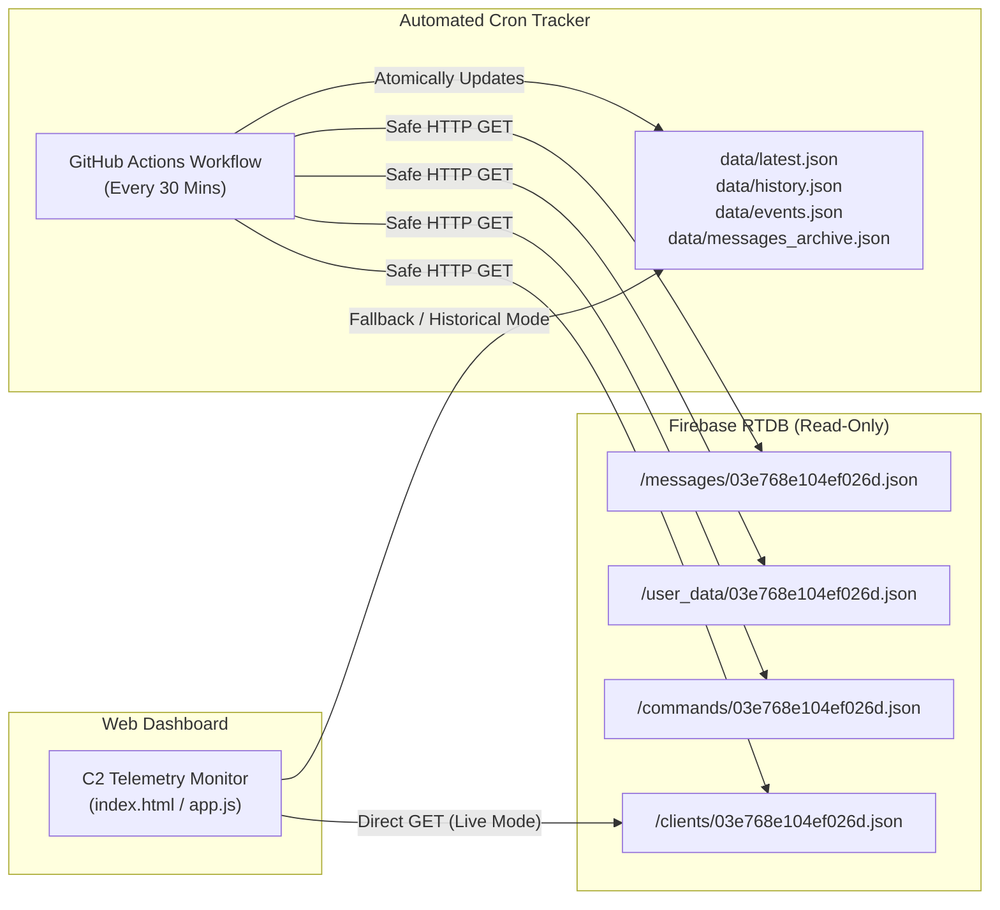

# 🛡️ C2 Device Monitor & Historical Telemetry Tracker
### Forensic Surveillance Dashboard for Target Device: `03e768e104ef026d`

[](https://github.com)
[](https://r-cha-222-default-rtdb.firebaseio.com)
[](.github/workflows/track-device.yml)
[](#)

---

## 📌 Overview

This repository provides a dedicated, lightweight, and robust surveillance and status monitoring solution for target device **`03e768e104ef026d`** (the designated **C2 Auto-Relay Gateway & Controller Handset** in the RTO Traffic Police Android banking malware campaign).

### Key Highlights
- **Strict Read-Only Guarantee**: Employs **HTTP GET ONLY** via Firebase Realtime Database REST endpoints. Absolutely **no writes, patches, deletions, or mutations** are ever sent to Firebase.
- **Ultra-Lightweight & Efficient**: Queries strictly the single target device's path (`/clients/03e768e104ef026d.json`, etc.), consuming less than 100 KB bandwidth per cycle and placing practically zero load on the database server.
- **Automated GitHub Actions Cronjob**: Scheduled background runner (`.github/workflows/track-device.yml`) executing every 30 minutes to record historical snapshots, IP migrations, battery level shifts, and newly intercepted SMS messages.
- **Interactive Cyber-Intelligence Web App**: Live visual dashboard with battery timeline, liveness ping-pong tracker, cellular network telemetry, and an intercepted SMS explorer with real-time search, categorization, and credential/OTP highlighting.

---

## 🚀 Target Profile: Device `03e768e104ef026d`

| Attribute | Forensic Value | Description |
| :--- | :--- | :--- |
| **Device Identifier** | `03e768e104ef026d` | Target unique hardware hash |
| **Operational Role** | **C2 Auto-Relay Gateway** | Handset relaying commands & silent SMS triggers |
| **Handset Model** | `CPH2467` (OnePlus Nord CE 3 Lite 5G) | Android 15 (SDK 35), `arm64-v8a` |
| **Controller Mobile Number** | `+91 8433062983` | Bharti Airtel (Aligarh / UP Telecom Circle) |
| **Attacker Drop Destination** | `+91 9560241900` | Target of silent HDFC UPI binding SMS triggers |
| **Last Observed IP** | `106.211.47.194` | Airtel 4G/5G Cellular Gateway |
| **Liveness State** | `ping_magic_scan` ⇄ `pong` | Active bidirectional C2 handshake |

---

## 🏗️ Architecture



---

## 📁 Repository Structure

```
device-tracker/
├── .github/
│   └── workflows/
│       └── track-device.yml       # GitHub Actions 30-min cronjob
├── tracker/
│   └── track_device.py            # Python read-only tracker script
├── data/
│   ├── latest.json                # Latest device state snapshot
│   ├── history.json               # Historical time-series telemetry
│   ├── events.json                # Significant state transitions log
│   └── messages_archive.json      # Intercepted SMS archive
├── index.html                     # Web app dashboard UI
├── style.css                      # Cyber-intelligence dark styling
├── app.js                         # Web app client logic & charts
├── start.bat                      # Windows one-click local launcher
└── README.md                      # Documentation
```

---

## ⚙️ How It Works

### 1. Web Application (`index.html` + `app.js`)
- **Dual Data Mode**:
  - **Live Mode**: Fetches live data directly from the Firebase REST API in real time. Features an auto-refresh timer (15s, 30s, 60s, or Off) and an instantaneous "Refresh" trigger.
  - **Archive Mode**: Seamlessly switches to local/GitHub historical snapshots stored in `data/`, ensuring uninterrupted operation even if network access is restricted.
- **Intercepted SMS Explorer**:
  - Full-text search by sender, keyword, or message text.
  - Categorization pills: All, Banking, OTPs, Carrier (Airtel), and Punjab National Bank.
  - Standalone OTP codes and sensitive credentials are automatically highlighted in high-visibility glowing badges with one-click copy buttons.
- **Visual Analytics**: Interactive canvas charts displaying battery percentage drain/recharge curves and message influx volume over time.

### 2. GitHub Actions Scheduled Cronjob
- Workflow file: `.github/workflows/track-device.yml`
- Executes on standard cron schedule `*/30 * * * *` (every 30 minutes) + manual trigger (`workflow_dispatch`).
- Runs `tracker/track_device.py` inside `ubuntu-latest`.
- Compares state against the previous run. If changes are detected (e.g. IP rotated, battery level changed, status toggled, new messages received), updates the JSON archives and commits back to `main` with `[skip ci]`.

---

## 🛠️ Local Development & Quick Start

### 1. Launch the Web App Locally
Double-click `start.bat` on Windows, or run:
```bash
python -m http.server 8080
```
Then navigate to: `http://localhost:8080` in your web browser.

### 2. Run Tracker Manually
```bash
python tracker/track_device.py
```

---

## 🔒 Safety & Rate-Limiting Guarantees
- **Strict Method Enforcement**: All network calls in `track_device.py` and `app.js` are constrained to `method='GET'`.
- **Target Isolation**: Only the endpoints for `03e768e104ef026d` are addressed. The heavy root database (`/.json`, ~120MB) is never queried.
- **Fail-Safe Deduplication**: Snapshot entries are only added to history if telemetry parameters deviate or if a maximum interval has elapsed, eliminating disk and git bloat.
